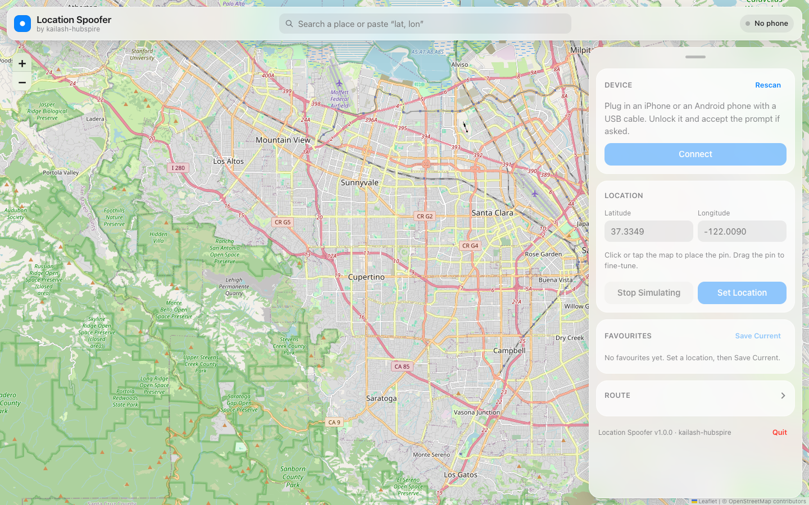

<p align="center">
  
</p>

<h1 align="center">Location Spoofer</h1>

<p align="center">
  Fake GPS on a physical iPhone or Android phone from your Mac. No jailbreak. No Xcode.<br>
  iOS uses Apple’s developer location simulation; Android uses a small USB-installed helper app.
</p>

<p align="center">
  
  
  
  <a href="LICENSE"></a>
</p>

<p align="center">
  
</p>

<details>
<summary>Table of contents</summary>

- [Features](#features)
- [Install](#install)
- [Requirements](#requirements)
- [Usage](#usage)
- [FAQ](#faq)
- [How it works](#how-it-works)
- [Testing MARTA live trips](#testing-marta-live-trips)
- [Build from source](#build-from-source)
- [License](#license)
- [Acknowledgements](#acknowledgements)

</details>

## Features

- **Place** – click the map, drag the pin, search a place, or paste `lat, lon`, then **Set Location**
- **Trip** – drop a GPX file (or draw a route) and see a summary first: distance, duration, walk/ride legs and the leave-by time. Timed GPX replays the real timetable, joining at the current clock; **Speed** plays it 2×, 5× or 10× faster
- **Start walking now** – for trips that begin with a walk: walk to the first stop straight away, wait there for the departure, then follow the timetable
- **Live trip panel** – what the rider is doing right now (walking, waiting at the stop with a countdown, on the bus or train, holding, arrived), progress and time left, **Hold** and **Stop trip**
- **Test tools** – one compact list, one tool open at a time:
  - **Off course** – any distance (0–5000 m, presets 100 · 300 · 450 · 500 · 600 · 1000), left or right, **Jump** or **Drift** over N seconds, then back on course the same way
  - **Pace** – any walking pace from 0.25× to 4×; rides stay on the timetable
  - **GPS signal** – **Frozen** (no updates), **Lost signal** (fixes too inaccurate to use; Android only), and **Jitter** up to ±100 m
  - **Activity log** – every action and trip event with its time and leg; **Copy log** for bug reports
- **Guided tour** – opens the first time and runs a practice trip with you (start it, watch the rider, go off course), so every step shows the real control; replay it from **?** in the top bar
- **Test scenarios** – step-by-step recipes with the expected result; **Set up** opens the right tool with the values filled in
- **Practice mode** – a demo phone and a ready-made sample trip (State Capitol → Five Points → Midtown), so you can learn the tools without a phone. Start it from the device pill or the end of the tour
- **Built-in help** – every tool and trip option has an **(i)** that explains how it works and which MARTA rule it hits. **MARTA rules** in the top bar lists every live-trip rule (off course, progress, GPS, missed departure, boarding, arrival, auto-end, reminders) in plain language: what the app does, what you see on the phone, and how to test it. Rules that need background have a **More detail** dropdown, and the sheet has a filter and section shortcuts
- **Map** – walks dotted grey, rides solid blue, stops marked; while off course a ghost dot shows the true position
- **Favourites** – one-click return to places you use often
- **iPhone (iOS 14 – 26)** – legacy usbmux service or iOS 17+ developer tunnel, no `sudo`. Nothing permanent installed on the phone
- **Android (8+)** – helper APK over USB (`adb`); mock location via test providers (`gps`, `network`, fused on API 31+)
- **Native feel** – light and dark mode, spring motion, works at phone widths too
- **Private by default** – runs on your Mac at `127.0.0.1:8420`. No accounts, no telemetry

## Install

Run from source (recommended for MARTA live-trip testing):

```bash
git clone https://github.com/kailashGN/marta-location-spoofer.git
cd marta-location-spoofer
./scripts/run.sh
```

Or double-click **Start Location Spoofer.command** in Finder, which runs the same script in a Terminal window. QA testers should follow the [user guide](docs/user-guide/README.md).

Run it from the repo root as shown (or `./run.sh` from inside `scripts/`). A bare `run.sh` won't work, because the shell doesn't look for commands in the current folder.

`run.sh` prints five numbered steps and stops on the first failure, naming the step. Output is also saved to `logs/setup.log`. Each step is skipped once done, so it doubles as the everyday launcher:

1. Checks macOS is 13 or newer, and clears the download quarantine flag if the repo came from a ZIP.
2. Gets Python 3.10+. It downloads [uv](https://github.com/astral-sh/uv) and uses it to install Python 3.11 into `.tools/`, with no admin rights and nothing outside the repo. Apple's `/usr/bin/python3` (3.9) is never used: playback creates asyncio primitives at import, which breaks on 3.9. If the download fails, it falls back to a Python 3.10+ already on PATH.
3. Creates `.venv`.
4. Installs `requirements.txt`, again whenever its checksum changes (stored in `.venv/.requirements.sha`).
5. Finds `adb` (PATH, `ANDROID_HOME`, Android Studio's SDK, `.tools/platform-tools`), or downloads Google's platform-tools into `.tools/`. A failed download is only a warning, because iPhones don't need it.

It then opens the UI at `http://127.0.0.1:8420`, or just opens the browser if Location Spoofer is already running. Overrides: `LS_PYTHON` (use this interpreter for `.venv`), `LS_UV_URL`, `LS_ADB_URL`.

To get a double-clickable **Location Spoofer.app** instead, see [Build from source](#build-from-source). Local builds are not notarized, so on first launch right-click the app and choose **Open**.

## Requirements

- macOS 13 Ventura or newer, Apple silicon or Intel
- **iPhone or iPad** on iOS / iPadOS 14 – 26, **or** an **Android phone** on Android 8 or newer, connected with a USB cable (physical devices are what this project targets; emulators are not the primary path)
- **iPhone:** Developer Mode enabled (Settings → Privacy & Security → Developer Mode)
- **Android:** Developer options and USB debugging on. `run.sh` downloads `adb` if the Mac doesn't have it.

Xcode is **not** required.

## Usage

<details open>
<summary><b>Start spoofing</b></summary>

1. Enable Developer Mode on the iPhone if you haven't yet (it restarts once).
2. Plug the phone into the Mac, unlock it, and tap **Trust** if asked.
3. Open Location Spoofer. It opens in your browser at `http://127.0.0.1:8420`.
4. Click the device pill at the top right (it opens by itself when no phone is connected).
5. **iPhone only:** if it shows **Prepare**, press it once – this mounts Apple's Developer Disk Image (keep the phone unlocked).
6. Press **Connect** (pick the device if several are listed).
7. In the **Place** tab, click anywhere on the map and press **Set Location**.

Maps, Find My, and every other app now see the new location.

**Android:** skip **Prepare**. Turn on USB debugging, plug in, and press **Connect**. That installs **Location Spoofer Helper** and grants mock location when the system allows. If the phone still refuses, open Developer options, select **Location Spoofer Helper** as the mock-location app, and press **Connect** again.

</details>

<details>
<summary><b>Move along a route</b></summary>

1. Open the **Trip** tab.
2. Drop a GPX file on the window (or click **Load a GPX file**), or choose **Draw a route on the map instead**.
3. Check the summary: legs, distance, and when the trip leaves.
4. **GPX with timestamps:** **Follow GPX timestamps** is on by default. Pick a **Speed** (1×, 2×, 5×, 10×, or a custom value under **More options**). The pin starts at **now** and skips past points.
   If the trip begins with a walk, turn on **Start walking now** to skip the wait before the leave-by time: the pin walks to the first stop straight away, waits there until the bus or train's scheduled departure, then follows the timetable.
5. **GPX without timestamps** or a drawn route: choose **Walk**, **Run**, **Bike** or **Drive**.
6. Press **Start trip**. The panel switches to the live view with the test tools underneath.

Keyboard: **Space** holds or resumes, **O** goes off course or back with the current settings, **Esc** closes the device popover.

</details>

<details>
<summary><b>Stop spoofing</b></summary>

Press **Stop Simulating** to return to the real GPS immediately, or **Disconnect** / **Quit**.
Rebooting the phone also restores the real location on iOS; on Android, disconnecting clears test providers.

</details>

## FAQ

**The location jumps back when I quit the app.**
Expected on iOS 17 and newer – Apple's location simulation only lives while the developer connection is open. Keep the app running while you need the fake location. On Android, disconnect or stop simulating to restore real GPS.

**An app still shows my real location.**
Force-quit that app and reopen it. Some apps cache the last fix for a few seconds. For MARTA live trips, turn off the in-app **Live Trip Simulator** in Secret settings so the app reads hardware GPS.

**"Developer Disk Image not mounted" keeps appearing.**
Unlock the phone, press **Prepare**, and wait for the toast. The first time needs internet to download the image from Apple.

**"Could not open a developer tunnel".**
Use a USB cable rather than Wi-Fi, make sure the phone is unlocked, quit Xcode or Instruments if they're open, then press **Connect** again.

**Android mock location does not stick.**
Confirm **Location Spoofer Helper** is the selected mock-location app in Developer options, then **Connect** again. Revoke and re-grant mock location if the system previously denied it.

**Does this work over Wi-Fi?**
No. The phone stays connected by USB, and the web UI only listens on `127.0.0.1`, so nothing else on your network can reach it.

**Is it safe?**
On iOS it uses the same mechanism Xcode uses for *Debug → Simulate Location*. On Android it uses the standard mock-location test-provider API. Nothing is permanently modified on either device. Some apps forbid location spoofing in their terms of service – use responsibly, and only on devices you own.

## How it works

The iPhone exposes a developer-only location-simulation service once Developer Mode is on and the Developer Disk Image is mounted. Location Spoofer talks to it directly:

| iOS | Service | Transport |
|---|---|---|
| 14 – 16 | `com.apple.dt.simulatelocation` | usbmuxd |
| 17 – 26 | DVT `LocationSimulation` | RemoteXPC tunnel via macOS `remoted` (no root) |

Android has no equivalent developer service. A small helper app ([`android/helper`](android/helper), APK at `android/helper.apk`) is installed once over USB and selected as the mock-location app. The Mac pushes coordinates through `adb forward` to `127.0.0.1:17321` on the device. `gps`, `network`, and fused providers follow those fixes. Disconnect or **Stop Simulating** removes them so the real GPS returns.

`scripts/build-helper.sh` rebuilds the APK when the helper changes.

A Python **FastAPI** service does the device work. iPhones go through [pymobiledevice3](https://github.com/doronz88/pymobiledevice3); Android phones go through `adb` and the helper. The interface is a local web page. Protocol notes and sources live in [`docs/RESEARCH.md`](docs/RESEARCH.md).

Two loops share the work: the route runner moves the on-course point along the route on its schedule, and a publisher sends that point to the phone once a second, moved by the current off-course offset and jitter. Resending an unchanged point adds a 0.3 m nudge so the phone keeps getting fresh readings (MARTA treats 20 s without one as GPS lost). Frozen stops the publisher; Lost signal sends fixes with 150 m accuracy, which MARTA drops.

**HTTP API:** the web UI drives the server over a local HTTP API.

| Endpoint | Body | Does |
|---|---|---|
| `POST /api/route/gpx` | `gpx`, `use_gpx_times`, `time_scale`, `walk_ahead`, `loop` | Play a GPX file |
| `POST /api/route` | `points`, `speed_mps`, `loop` | Play a drawn route |
| `POST /api/route/pause` | `paused` | Hold or resume |
| `POST /api/offset` | `side` (`left`/`right`/`none`), `meters` (0–5000), `ramp_s` (0–600) | Off course; `ramp_s` > 0 drifts. Works without a route too |
| `POST /api/route/pace` | `factor` (0.25–4) | Walking pace |
| `POST /api/gps` | `mode` (`normal`/`frozen`/`lost`), `jitter_m` (0–200) | GPS signal; `lost` is Android-only |
| `GET`/`DELETE /api/log` | | Activity log |
| `POST /api/demo` | `{enabled}` | Practice mode on or off (off also disconnects the demo phone) |
| `GET /api/demo/sample.gpx` | | Sample trip, timed from now |
| `DELETE /api/route` | | Stop the trip and stay where it ended |

## Testing MARTA live trips

📖 **Step-by-step guide with screenshots:** [docs/user-guide](docs/user-guide/README.md)

New here? Press **?** for the tour. It starts a practice trip on a demo phone and walks you through it. Then open **Test scenarios** for step-by-step checks.

To test a real live trip on a phone without travelling, download the trip's GPX from the MARTA app and play it back here. The MARTA app never talks to Location Spoofer: you move the file across by hand.

1. Connect the phone (see [Usage](#usage)). Keep the spoofer running for the whole test.
2. In a non-production MARTA build, open the Secret menu (**More** tab, then 5 taps with two fingers) and make sure **Live Trip Simulator** is **OFF**. Otherwise the app ignores real GPS.
3. Plan a trip and press **Start**.
4. In the Secret menu, tap **Download GPX** (shown only while a trip is active), and send the file to the Mac (AirDrop, Drive, email…).
5. Drop the file on the spoofer's **Trip** tab. Keep **Follow GPX timestamps** on and **Speed** at `1×`. Turn on **Start walking now** if you don't want to wait for the leave-by time. Press **Start trip**.
6. Use the test tools below. The table shows which MARTA rule each one exercises.
7. When you're done, end the trip in the app, then press **Stop trip** and **Stop Simulating** to get the real GPS back.

Load the GPX soon after downloading it. Its times are the real timetable, so playback joins at the current time and skips points already in the past. If the whole trip is already over, the summary says so and Start is disabled: start a new trip and download a fresh GPX.

| To test | Do this | MARTA rule |
|---|---|---|
| No off-course card inside the threshold | Off course **700 m**, Jump | Off course needs **> 805 m** (½ mile) from the current or a later leg |
| Off-course card | Off course **1000 m**, Jump | “It looks like you might have lost your way.” after **30 s** past 805 m |
| Card timing follows the crossing | Off course **1000 m**, **Drift** over 60 s | The 30 s starts when the fix crosses 805 m (about 48 s in, so the card shows at about 78 s) |
| Back on course | **Back on course** (or Drift back) | Clears after **10 s** within 805 m |
| Progress stops but no card | Off course **100–700 m** | Progress radius is **50 m** |
| Missed departure | **Hold** at the stop past departure | Within **150 m** of the stop and **> 60 s** after departure |
| “Can’t make it” switch | **Pace 0.5×** (or lower) on the walk to the stop | Projected arrival > departure + 60 s for **30 s** |
| GPS lost | GPS signal **Frozen** (or **Lost signal** on Android) | “No GPS signal” after **20 s** with no usable fix; fixes worse than **100 m** don’t count |
| No false off-course from noisy GPS | **Jitter ±40 m** | Distance check uses the raw fix |
| Arrival prompt and auto-end | Let the trip finish; it holds at the destination | Prompt within **50 m**; auto-end within **30 m** for **5 min** |

**Copy log** in the Activity log gives a timestamped list of everything you did, ready to paste into a ticket.

## Build from source

```bash
python3 -m venv .venv && .venv/bin/pip install -r requirements.txt pyinstaller
.venv/bin/python -m unittest discover -s tests -t .     # run the tests
scripts/build-helper.sh                                  # Android helper APK → android/helper.apk
scripts/build-app.sh                                     # produces dist/Location Spoofer.app (+ .zip)
```

`scripts/build-helper.sh` is only needed when the helper source changes (a prebuilt `android/helper.apk` is committed). It uses Android Studio's bundled JDK and `~/Library/Android/sdk` by default; override with `JAVA_HOME` / `ANDROID_HOME`.

Signing and notarizing a release (`scripts/notarize.sh`) needs a Developer ID certificate and an App Store Connect API key; it's optional for internal use.

```
backend/    FastAPI server, device discovery, iOS / Android / demo drivers, geometry, spoof session
frontend/ index.html · app.css · spring.js · core.js · map.js · device.js · place.js · trip.js · tools.js · info.js · tour.js · app.js  (no build step)
android/  helper app that injects mock fixes, plus the committed debug APK
packaging/ app icon
docs/     research notes, design rules
scripts/  run.sh, build-helper.sh, build-app.sh, notarize.sh
tests/    unit tests
```

Environment: `LS_HOST` (default `127.0.0.1`), `LS_PORT` (default `8420`), `LS_LOG` (default `INFO`), `LS_NO_BROWSER=1` (don't open the browser on start).

**Working on the UI without a phone:** use **Practice with a demo phone** in the device popover, or start with `LS_DEMO=1 ./scripts/run.sh` to list the **Demo phone** from the start. It accepts everything and sends nothing. Add `LS_DEMO_PLATFORM=android` to try the Android-only controls. Use another `LS_PORT` to run it next to a real session.

## Changelog

**2.0.1**
- Guided tour starts a practice trip first (demo phone + sample trip), starts it with you and points at the real trip summary, live panel and test tools, with “Try it” steps you can do inside the spotlight
- MARTA rules rewritten for QA testers: plain-language descriptions, what you see on the phone, **More detail** dropdowns, a “New to live trips?” primer, clearer section headers and section shortcuts
- Fix: MARTA's off-course distance is now **805 m** (½ mile), not 500 m. Off course presets, readouts, scenarios and the default distance (1000 m) follow it
- Fix: “No later departure” shows “Your trip may not be possible as planned.”, and the leave-by reminder is 3 min before the first leg starts

**2.0.0**
- New layout: device details in the top-bar pill; **Place** and **Trip** tabs; a live trip panel with test tools underneath
- Trip summary before you start: legs, distance, duration and leave-by time; drag and drop GPX
- **Start walking now** for trips that begin with a walk
- Off course at any distance, left or right, jump or drift; works on a static location too
- Any walking pace from 0.25× to 4×
- GPS signal: Frozen, Lost signal (Android), Jitter
- Activity log with copy
- (i) explanations on every tool, and a filterable MARTA live-trip rules sheet
- Guided tour on first run (replay from **?**), **Test scenarios** with one-click Set up, and **Practice mode** with a sample trip
- The server tells browsers to re-check page files, so an upgrade shows up without a hard reload
- Map shows legs, stops and the true position while off course
- Fix: the off-course hint said 50 m; MARTA uses 500 m
- Android helper 2: accepts an accuracy per fix, plus `FREEZE` / `RESUME` (installed automatically on Connect)

## License

[MIT](LICENSE)

## Acknowledgements

- [pymobiledevice3](https://github.com/doronz88/pymobiledevice3) – the pure-Python iDevice toolkit this is built on
- [LocationSimulator](https://github.com/Schlaubischlump/LocationSimulator) – prior art for iOS ≤ 16
- [Leaflet](https://leafletjs.com) and [OpenStreetMap](https://www.openstreetmap.org) contributors
