# Location Spoofer: test a MARTA live trip from your desk

Location Spoofer lets you take a MARTA trip without leaving your desk. It moves your test phone's GPS along the route, so the MARTA app thinks you're walking to the stop and riding the bus or train. On the way, you can push the rider off course, slow them down or cut the GPS signal, and check that the app reacts the right way.

In short: you start a trip in the MARTA app, send the trip file to your Mac, and Location Spoofer plays it back on the phone through the USB cable.

## What you need

- A Mac with macOS 13 (Ventura) or newer. To check, click the Apple menu  in the top-left corner and choose **About This Mac**.
- An iPhone or Android phone with the MARTA app, and a cable to plug it into the Mac.
- Internet, and about 15 minutes for the first-time setup.

---

## First-time setup

You do this once on each Mac and once for each phone.

### 1. Download Location Spoofer

1. Go to [github.com/kailashGN/marta-location-spoofer](https://github.com/kailashGN/marta-location-spoofer). If the page says it can't be found, ask the dev team to give your GitHub account access.
2. Click the green **Code** button, then **Download ZIP**.
3. Open your **Downloads** folder and double-click the ZIP to unzip it.
4. Move the new **marta-location-spoofer-main** folder into your **Documents** folder.

> **Used Git before?** You can clone the repo instead of downloading the ZIP:
> `git clone https://github.com/kailashGN/marta-location-spoofer.git`

### 2. Start it for the first time

1. Open the folder and double-click **Start Location Spoofer.command**.
2. macOS will probably say it can't check the file for harmful software. That's normal for tools we build ourselves. Click **Done**, then:
   1. Open **System Settings** and go to **Privacy & Security**.
   2. Scroll down to the message about **Start Location Spoofer** and click **Open Anyway**.
   3. Enter your Mac password if it asks, then click **Open Anyway** again.
3. If your Mac asks whether Terminal can access files in your Documents folder, click **Allow**.

A Terminal window opens and goes through five setup steps. The first time, they download everything Location Spoofer needs, which takes a few minutes:

1. **Checking your Mac** makes sure macOS is new enough.
2. **Getting Python** downloads Python, the language Location Spoofer is written in. It stays inside the Location Spoofer folder and doesn't change anything else on your Mac.
3. **Preparing Location Spoofer** sets up a space for its parts.
4. **Installing the parts it needs** downloads them. A lot of text scrolls past here. That's normal.
5. **Checking Android tools** downloads Google's tools for talking to Android phones.

Each step ends with a green **✓**. When all five are done, Location Spoofer opens in your web browser.

**If a step shows a red ✗**, setup stops and says which step went wrong. Take a screenshot of the Terminal window and send it to the dev team, together with the file **setup.log** from the **logs** folder inside Location Spoofer.

A yellow **!** is only a warning, and setup carries on. For example, if the Android tools don't download, iPhones still work. Start Location Spoofer again later to retry.

### 3. Get your phone ready

**iPhone**

1. Plug the iPhone into the Mac and unlock it.
2. If it asks **Trust This Computer?**, tap **Trust** and enter your passcode.
3. Open **Settings → Privacy & Security → Developer Mode** (near the bottom), turn it on and tap **Restart**.
4. After the restart, unlock the phone and tap **Turn On** when it asks.

Don't see **Developer Mode**? Ask the dev team. It only shows up once the phone has been set up for testing.

**Android**

1. Open **Settings → About phone** and tap **Build number** seven times, until it says you're now a developer. On a Samsung, **Build number** is under **About phone → Software information**.
2. Go back to **Settings** and open **Developer options**. On most phones it's under **System**. On a Samsung, it's at the very bottom of Settings.
3. Turn on **USB debugging**.
4. Plug the phone into the Mac. When it asks **Allow USB debugging?**, tick **Always allow from this computer** and tap **Allow**.

---

## Part 1: On the phone

This 26-second video shows all three phone steps:

https://github.com/user-attachments/assets/1607c21b-9071-46e5-a8ca-3927c8c752f5

Video not playing? [Open it here](videos/phone-walkthrough.mp4).

Here you start a trip in the MARTA app and save it as a GPX file. A GPX file is the trip's route with a time for each point, which is what Location Spoofer plays back.

> **Testing the App Store or Play Store version?** It doesn't have the secret menu, so skip Steps 1 and 3. Ask someone with a test build for a fresh GPX file, then carry on with Part 2. Location Spoofer works the same with any version of the app.

### Step 1. Get the MARTA app ready

1. In the MARTA app, open the **More** tab and tap the screen five times with two fingers. The secret menu opens.
2. Under **Mock Location**, tap **Use real location** if it isn't already selected.
3. Under **Live Trip Simulator**, turn **Use the simulator** off.

The simulator has to be off. While it's on, the app ignores the phone's GPS, so Location Spoofer can't move it.

<!-- TODO: phone screenshot of the secret menu (Mock Location + Live Trip Simulator off)

-->

### Step 2. Start a live trip

Plan a trip from **Current Location** and tap **Start** on the itinerary.

**Start** only shows for trips that begin at Current Location and leave now. To start any trip, turn on **Offer Start on any trip** in the secret menu.

<!-- TODO: phone screenshot of the itinerary with the Start button

-->

### Step 3. Save the trip as a GPX file

1. While the trip is running, open the secret menu again.
2. Under **Download live trip GPX**, tap **Download GPX**.
3. Send the file to your Mac. AirDrop is quickest; email or Google Drive work too.

Use the file soon after you download it. Its times follow the real bus and train timetable, so an old file describes a trip that's already over.

<!-- TODO: phone screenshot of the Download GPX section

-->

---

## Part 2: In Location Spoofer (on the Mac)

> The screenshots below were taken in practice mode, so the button at the top right says **Practice**. With your phone connected, it shows the phone's name instead, for example **iPhone · Trip running**.

### Step 4. Open Location Spoofer

If it isn't open already, double-click **Start Location Spoofer** in the Location Spoofer folder. The five setup steps run again, but they only take a few seconds now. Then the page opens in your browser.

The first time, a short tour offers to walk you through a practice trip. Take it, or click **Not now**.

**Keep the Terminal window open the whole time you test.** Closing it stops Location Spoofer.

If the page doesn't open, go to http://127.0.0.1:8420 in your browser.

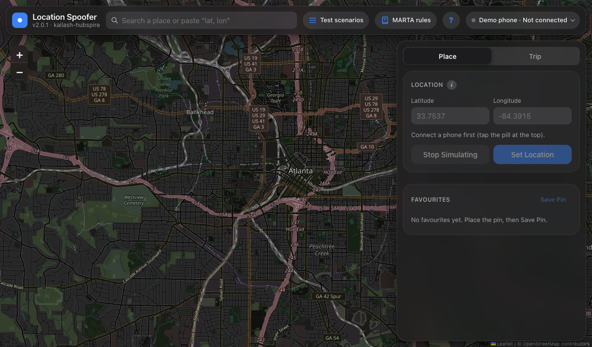

### Step 5. Connect the phone

1. Click the button at the top right to open the **Device** panel.
2. If more than one phone is plugged in, pick yours from the list.
3. **iPhone only:** if you see **Prepare**, click it once and wait until it finishes. The first time needs internet.
4. Click **Connect**.

The button turns to **Connected** with a green dot.

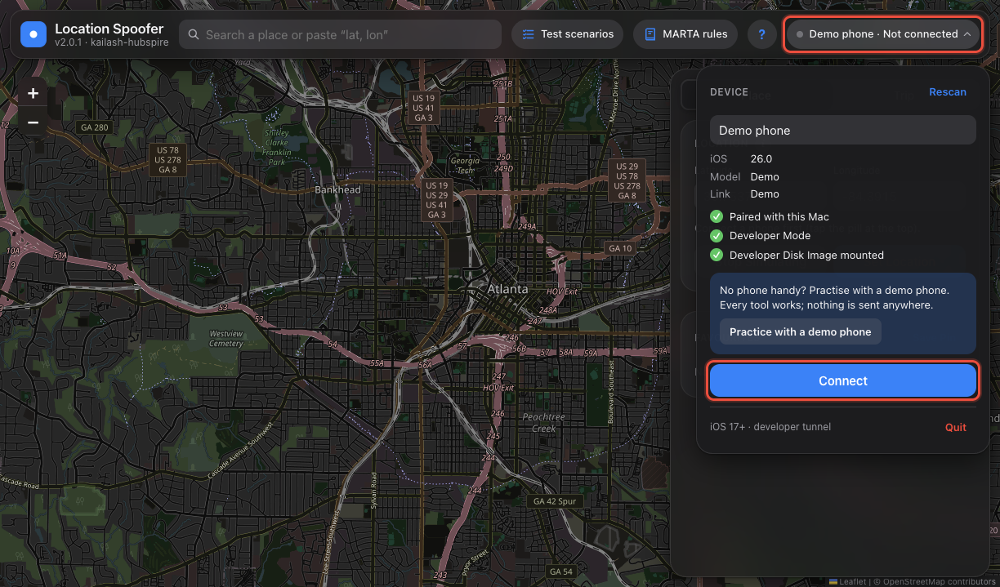

### Step 6. Load the GPX file

Open the **Trip** tab. Click **Load a GPX file** and choose the file from Step 3, or drag the file onto the box.

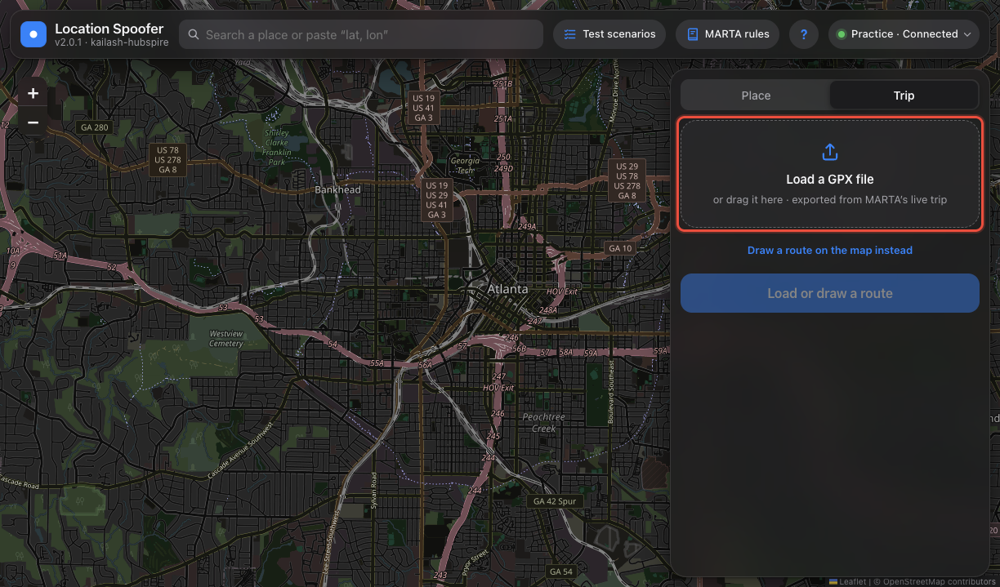

You'll see a summary of the trip: how long it is, the walking and riding parts, and when the rider needs to leave. The route shows on the map. Walks are dotted lines, and rides are solid blue.

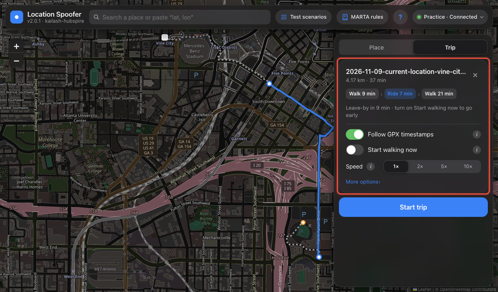

### Step 7. Choose how the trip plays, then start it

- **Follow GPX timestamps:** leave this on, so the trip follows the real timetable.
- **Start walking now:** turn this on if you don't want to wait until it's time to leave. The rider walks to the first stop straight away, waits there for the bus or train, then follows the timetable.
- **Speed:** leave it at **1×** to test in real time. **2×**, **5×** and **10×** play the trip faster.

Click **Start trip**. The button's label shows what you picked, for example **Start trip · walk now**.

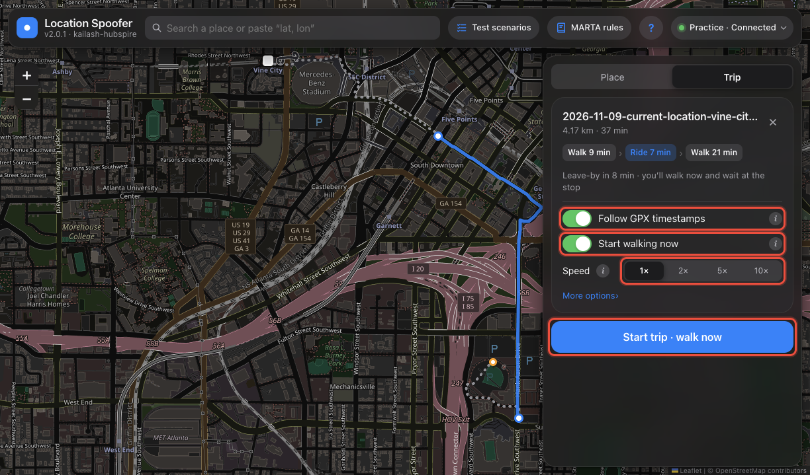

### Step 8. Watch the trip

The panel shows what the rider is doing: **Walking**, **Waiting at the stop**, **On the bus or train** or **Arrived**. It also shows how far along they are and how much time is left. The blue dot on the map is where the phone thinks it is. It moves about once a second.

- **Hold** keeps the rider where they are. For example, hold them at a stop past the departure time to test a missed bus. Click **Resume** to carry on.
- **Stop trip** ends the trip.

The test tools are underneath. One opens at a time.

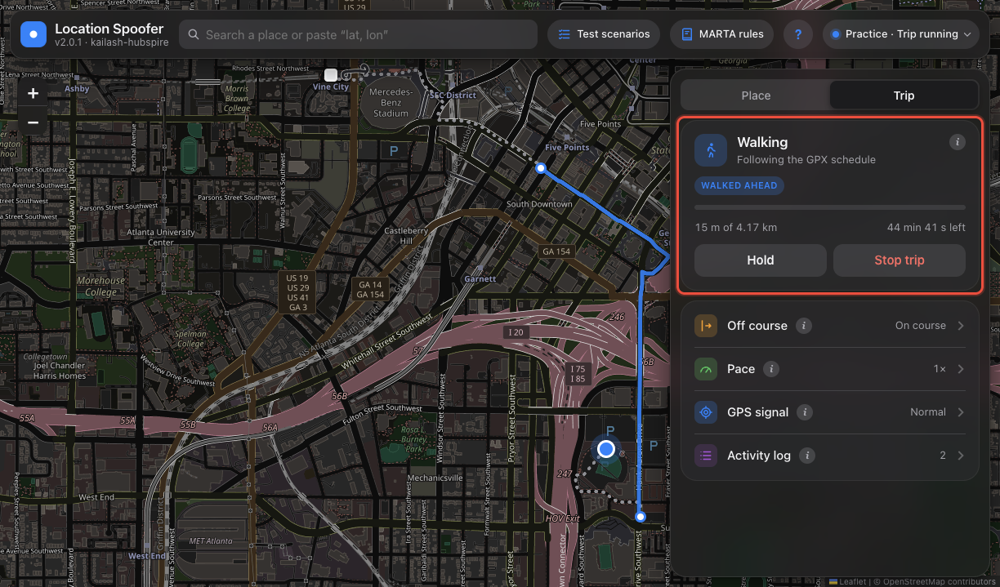

### Step 9. Test how the app reacts

#### Off course

Moves the rider away from the route.

1. Pick how far (100 to 1500 m), which side (**Left** or **Right**) and how they move. **Jump** moves them at once. **Drift** moves them bit by bit over the number of seconds you set.
2. Click **Go off course**. The orange dot on the map is where the phone now thinks it is. The dashed line leads back to the route.
3. Click **Back on course** to return.

**What MARTA should do:** show its off-course card once the rider has been more than **805 m** (half a mile) away for **30 seconds**. The card goes away after **10 seconds** back within 805 m.

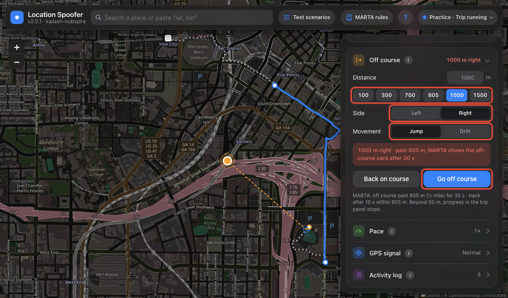

#### Pace

Makes the rider walk faster or slower (0.25× to 4×). Bus and train rides stay on the timetable.

**What MARTA should do:** if the rider walks to a stop at **0.5×** or slower, they'll miss the bus or train. After about 30 seconds, MARTA moves the trip to a later departure.

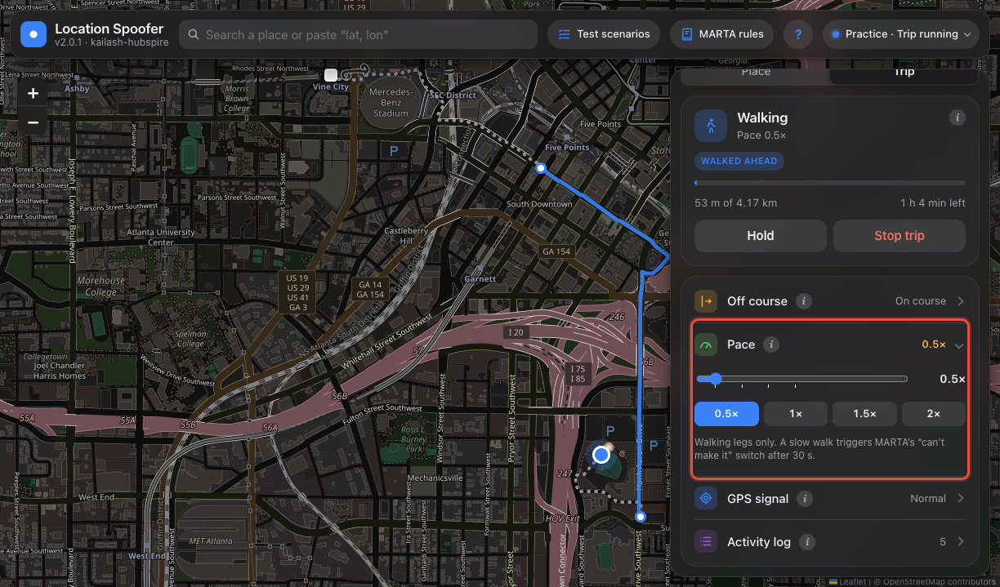

#### GPS signal

- **Frozen** stops the GPS updates. **What MARTA should do:** report that GPS is lost after **20 seconds**.
- **Lost signal** (Android only) sends locations too vague for MARTA to use.
- **Jitter** makes the location jump around by up to 100 m. **What MARTA should do:** no off-course alert from the noise alone.

Set it back to **Normal** when you're done.

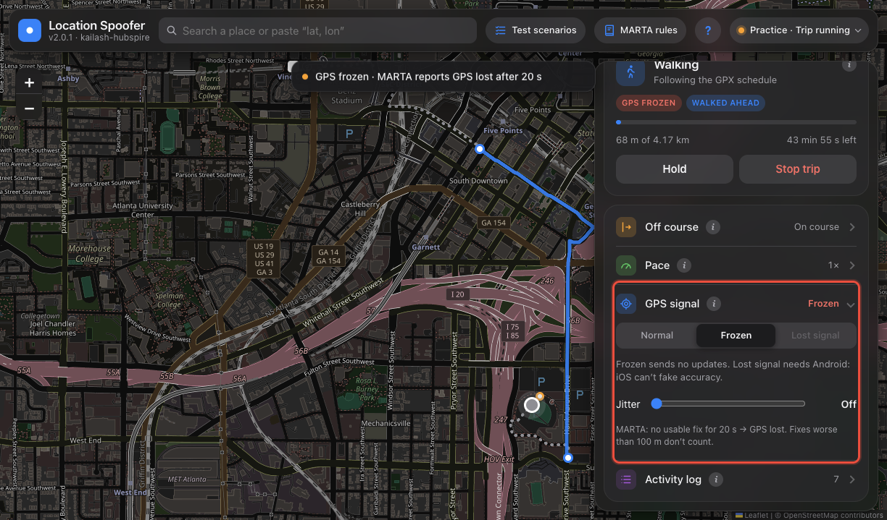

#### Activity log

Lists everything you did and everything that happened on the trip, with times. When you find a bug, click **Copy log** and paste it into the Jira ticket.

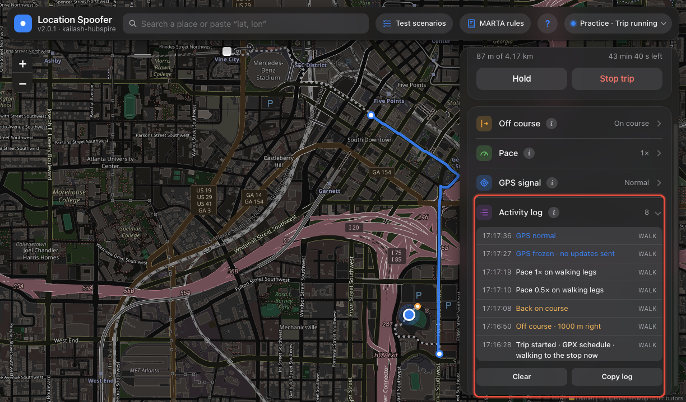

### Step 10 (optional). Use the built-in help

- **Test scenarios** (top bar) lists ready-made checks, each with the result to expect. **Set up** opens the right tool with the values already filled in.
- **MARTA rules** explains each live-trip rule in plain words: what the app does, what you see on the phone, and how to test it.
- The **i** buttons next to each tool explain what that tool does.

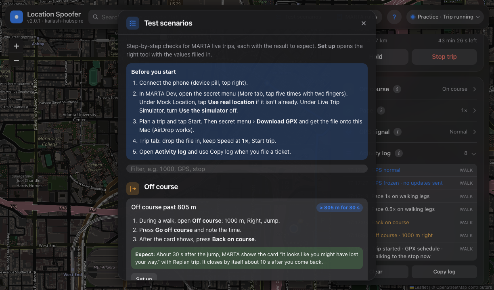

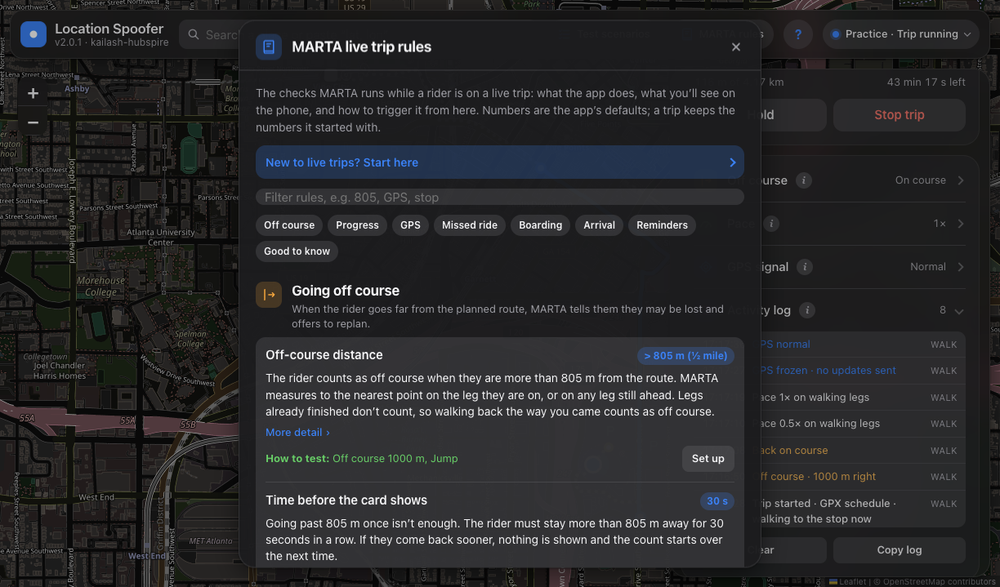

### Step 11. Finish

1. End the trip in the MARTA app.
2. In Location Spoofer, click **Stop trip**. The phone stays at the last spot.

   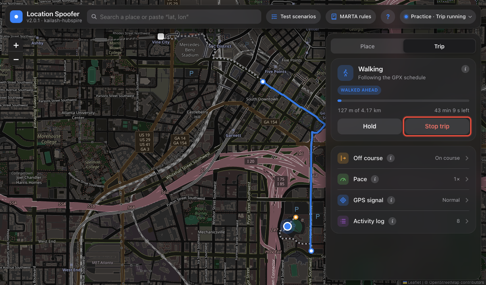

3. Open the **Place** tab and click **Stop Simulating**. This gives the phone its real GPS back.

   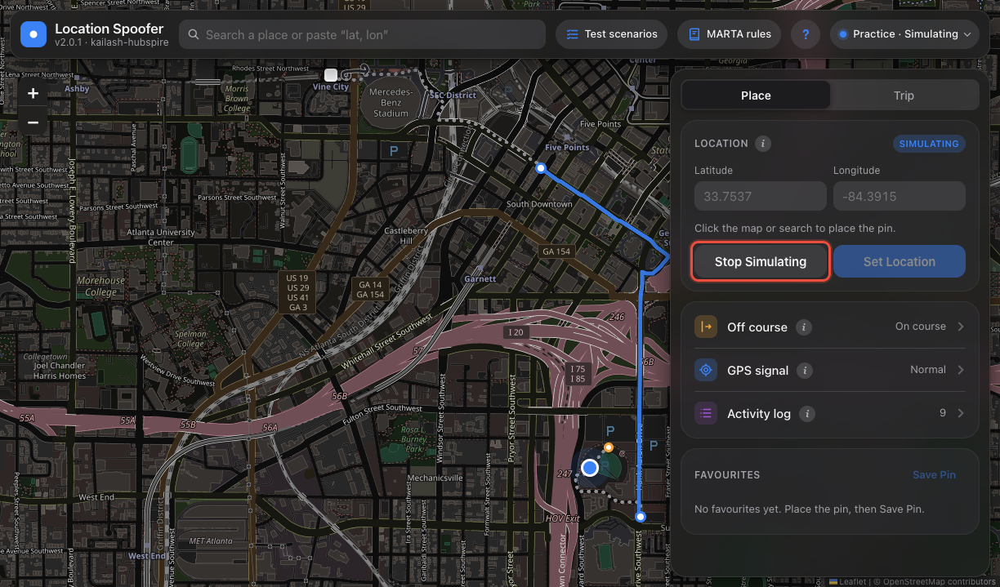

4. Click **Quit** in the Device panel, then close the Terminal window.

---

## Every time after the first

1. Plug in the phone and unlock it.
2. Double-click **Start Location Spoofer**.
3. Start a trip on the phone and send yourself the GPX file (Part 1).
4. Connect the phone, load the file and start the trip (Part 2).

---

## If something goes wrong

| What you see | What to do |
|---|---|
| A red **✗** in the Terminal window | Take a screenshot and send it to the dev team, together with **logs/setup.log** from the Location Spoofer folder. |
| "Couldn't download…" during setup | Check your internet connection and double-click **Start Location Spoofer** again. |
| macOS won't open **Start Location Spoofer** | Follow step 2 of the first-time setup (**System Settings → Privacy & Security → Open Anyway**). |
| "Location Spoofer is already running" | It's open in another Terminal window. Use that one, or close it and start again. |
| Your phone isn't in the list | Unlock the phone, check the cable, tap **Trust** (iPhone) or **Allow** (Android) on the phone, then click **Rescan** in the Device panel. |
| "Developer Mode is off" (iPhone) | Turn it on: **Settings → Privacy & Security → Developer Mode**. See step 3 of the first-time setup. |
| "Developer Disk Image not mounted" (iPhone) | Keep the phone unlocked and click **Prepare**. The first time needs internet. |
| "Could not open a developer tunnel" (iPhone) | Use the USB cable rather than Wi-Fi, close Xcode if it's open, then click **Connect** again. |
| Android: the fake location doesn't stick | On the phone, open **Developer options → Select mock location app**, choose **Location Spoofer Helper**, then click **Connect** again. |
| **Start trip** is greyed out and says "This trip is already over" | The GPX file is too old. Start a new trip in the app and download a fresh file. |
| The MARTA app ignores the fake location | In the secret menu, check that **Use the simulator** is off and **Use real location** is selected (Step 1). Then close the MARTA app fully and open it again. |

Still stuck? Send the dev team a screenshot of what you see, and the **Copy log** text from the Activity log if a trip was running.
